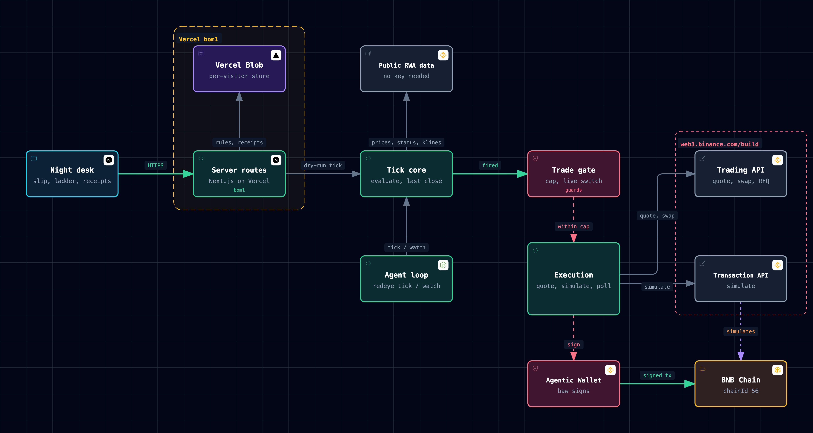
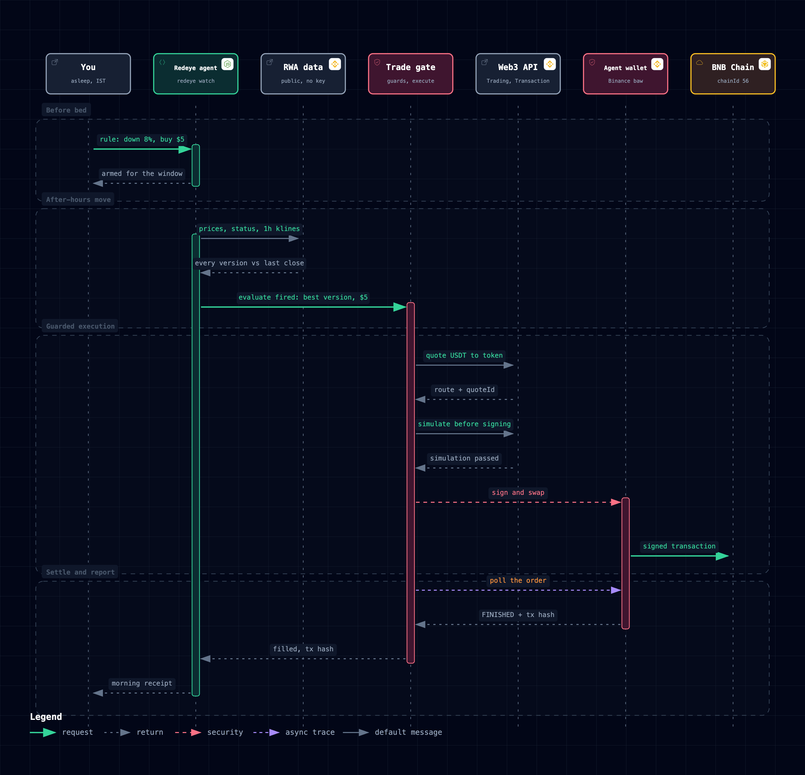

# Redeye

Act while you sleep.

Redeye is an earnings-night agent for people in India, Singapore and Southeast Asia who hold US stocks. US companies report at 4 pm in New York, which is 1:30 am in Mumbai and 4 am in Singapore, and the price moves while the holder is asleep. Before bed you write one rule in plain English, such as "if TSLA drops 8% buy $6". Redeye watches every tokenized version of that stock on BNB Chain (Ondo, bStocks and xStocks) through US after-hours, picks the version that can trade at the best price, checks the trade against hard limits, simulates it, signs it with the Binance Agentic Wallet, polls the order to a terminal state and leaves a receipt with the transaction hash for the morning.

Live: https://redeye-bnb.vercel.app

## How it works



Two entry points share one core. The night desk (Next.js on Vercel, region bom1) reads the market, parses a rule, arms it into a per-visitor Vercel Blob store and runs a scheduled dry-run tick. The agent loop (`bin/redeye.ts`, `tick` and `watch`) runs the same tick core with signing enabled. The tick core reads public RWA data, measures the move from the last US close, and hands a fired decision to the trade gate. The gate enforces the cap and the live switch, then the execution layer quotes through the Trading API, simulates through the Transaction API, signs through `baw` and settles on BNB Chain.

Interactive versions of both diagrams are in `docs/architecture/` as standalone HTML with SVG and JSON sources next to them.

### One earnings night



1. Before bed: the rule is parsed against a strict schema (exact pattern first, Claude as the fallback when `ANTHROPIC_API_KEY` is set) and armed with a watch window, set around the earnings report when its date is on file and through the next US after-hours session otherwise.
2. After the close: the last regular-session close is read from the Ondo or bStocks 1h candle that opens at 15:00 New York. Every version is priced per share, and the move is measured against that close.
3. When the trigger is met, `evaluate` drops versions that are paused or limited and drops derived prices that sit more than 2% from a live trade, then picks the cheapest version for a buy and the dearest for a sell.
4. The trade gate checks the per-trade cap, the Ondo minimum and the live switch. Execution quotes, builds the swap, simulates it and signs through `baw`.
5. The order is polled to a terminal state. The receipt records the quote, the simulation result, the order id and the transaction hash.

## Binance Web3 API modules

Public RWA endpoints (no key), `https://www.binance.com/bapi/defi`:

| Module | Path | Used for |
|---|---|---|
| Stock list | `/v1/public/wallet-direct/buw/wallet/market/token/rwa/stock/detail/list/ai?type=1\|2\|3` | Ondo, xStocks and bStocks tokens on chainId 56 |
| Dynamic price | `/v2/public/wallet-direct/buw/wallet/market/token/rwa/dynamic/ai` | Token price, share multiplier, independent stock price |
| Market status | `/v1/public/wallet-direct/buw/wallet/market/token/rwa/market/status/ai` and `.../asset/market/status/ai` | Session state, reason codes, per-token pauses and limits |
| Klines | `/v1/public/wallet-direct/buw/wallet/dex/market/token/kline/ai` | Last close, replay data |

Signed RWA build endpoints, `https://web3.binance.com/build`, authenticated with `BINANCE_W3_API_KEY` and `BINANCE_W3_API_SECRET`:

| Module | Path | Used for |
|---|---|---|
| Trading API quote | `GET /api/v1/dex/aggregator/quote` | Best SWAP or RFQ route and `quoteId` |
| Trading API approve | `GET /api/v1/dex/aggregator/approve-transaction` | Allowance calldata |
| Trading API swap | `GET /api/v1/dex/aggregator/swap` | Swap transaction, or the RFQ typed data to sign |
| Trading API RFQ | `POST /api/v1/dex/aggregator/order/submit`, `GET /api/v1/dex/aggregator/order/{orderId}` | Ondo order submission and fill polling |
| Trading API history | `GET /api/v1/dex/aggregator/history` | Confirmation of the approval transaction |
| Transaction API | `POST /api/v1/dex/pre-transaction/simulate` | Simulation before anything is signed |
| Transaction API | `POST /api/v1/dex/pre-transaction/broadcast-transaction` | Broadcast, carried by the same client |
| Wallet API | `POST /api/v1/dex/balance/token-balances-by-address` | Holding size for sell-a-fraction rules |

Binance Agentic Wallet (`baw`), driven through its `--json` CLI: `wallet address`, `wallet settings`, `market-order swap` and `list`, `sign-message` (typed-data signing for Ondo RFQ orders) and `contract-call` (approvals).

## Tokenized stocks

TSLA, NVDA, AAPL, NFLX and JPM each trade on BNB Chain (chainId 56) in all three versions. The live stock lists return them as:

| Ticker | Ondo (RFQ) | xStocks (SWAP) | bStocks (MIXED) |
|---|---|---|---|
| TSLA | TSLAon | TSLAx | TSLAB |
| NVDA | NVDAon | NVDAx | NVDAB |
| AAPL | AAPLon | AAPLx | AAPLB |
| NFLX | NFLXon | NFLXx | NFLXB |
| JPM | JPMon | JPMx | JPMB |

Redeye normalises every version to price per share, including the Ondo share multiplier, so the three can be compared and chosen between on one scale.

## The TSLA earnings night

Tesla reported after the close on 22 July 2026. The 1h klines of TSLAon and TSLAB on BNB Chain, read from the public kline endpoint, tracked the real stock's after-hours and premarket prices within about 0.5% in every hour, so a rule written against the token acts on the real move. The reaction landed in the tokens between 20:00 and 21:00 UTC, which is 1:30 to 2:30 am IST.

| UTC | TSLA (extended hours) | TSLAon | TSLAB |
|---|---|---|---|
| 2026-07-22 20:00 | 364.51 | 364.65 | 364.76 |
| 2026-07-22 21:00 | 358.48 | 358.38 | 357.87 |
| 2026-07-23 08:00 | 353.13 | 352.97 | 353.23 |
| 2026-07-23 12:00 | 345.90 | 345.53 | 345.13 |

The `/proof` route replays this night on a scrubbable Mumbai clock, runs the real rule over the recorded candles and prints the receipt at the firing hour. The candles are in `src/signals/fixtures/tsla-earnings-2026-07-23.tsv`.

## Safety design

- **A per-trade cap, enforced in code.** Every trade passes `guardedTrade` (`src/agent/guards.ts`) before `execute` is called. The default cap is $5 and `--max-usd` sets it. The comparisons are written as negations, so a NaN or missing amount is refused.
- **Simulate before sign.** The Transaction API simulation must pass before any signature is requested. An unrecognised simulation status counts as a failure.
- **A live switch with two keys.** Orders are signed only when the command carries `--live` and the environment has `REDEYE_LIVE=yes`. Without both, the banner reads DRY RUN and the run quotes and simulates only.
- **The wallet's own limit is respected.** `baw wallet settings` reports the daily limit set in the Binance App, and a trade larger than the remaining quota is declined. Live RFQ orders for Ondo check that Developer Mode is on before they start.
- **Poll to a terminal state.** Orders are polled every 2 seconds for up to 120 seconds. An order still pending at the deadline is recorded as failed. A `baw` order is filled only when it is FINISHED and carries a valid 32-byte transaction hash. An RFQ order is filled only when the vendor reports FILLED.
- **A live order that stays unconfirmed locks its rule.** The rule moves to review and never fires again unattended, so one order cannot become two.
- **Price impact and Ondo minimums are checked before signing.** A route whose impact exceeds the rule's slippage is refused, and Ondo orders below $5.01 fall through to the next best version.
- **The web desk never signs.** Server routes quote and simulate from a probe wallet that holds nothing, and `/api/tick` runs only with the cron bearer secret. Keys stay on the server.
- **Every decision leaves a receipt.** A check that fires, skips or fails is recorded with its reason in one sentence, together with the quote, the simulation result, the order id and the transaction hash when one exists.

## Run it locally

Requires Node 24 or newer.

```bash
cp example.env .env && chmod 600 .env   # then fill BINANCE_W3_API_KEY and BINANCE_W3_API_SECRET
```

`example.env` documents each variable. `ANTHROPIC_API_KEY` is optional: without it the strict parser handles the common rule shapes. Public RWA data needs no key.

The CLI is `bin/redeye.ts`. Alias it once, from the repo root:

```bash
alias redeye='node --env-file-if-exists=.env bin/redeye.ts'
redeye rule add "if TSLA drops 8% buy $6" --window 2026-07-22T19:00:00Z 2026-07-23T13:30:00Z
redeye rule list
redeye quote TSLA 6                  # every BSC version of TSLA with a Trading API quote
redeye tick                          # one pass, dry run
redeye watch --every 300             # the overnight loop, dry run
redeye watch --live --max-usd 5      # signs, only with REDEYE_LIVE=yes in .env
redeye receipts --last 20
```

Signing needs the Binance Agentic Wallet CLI: `npm install -g @binance/agentic-wallet@1.10.0`, then sign in once with the QR scan in the Binance App.

The night desk:

```bash
cd web && npm install && npm run dev
```

On Vercel, `web/vercel.json` schedules `/api/tick` every 10 minutes. Set `CRON_SECRET` in the project environment and `BLOB_READ_WRITE_TOKEN` for the per-visitor store.

## Tests

```bash
npm test
```

The suite runs on Node's built-in test runner against the parser, the evaluator, the guards, the execution paths for SWAP and RFQ, the poll-to-terminal logic, the `baw` wrapper, the Web3 API client and request signing, the last-close calculation and both stores. The night desk's session math has its own tests: `cd web && node --test lib/night.test.ts`.
